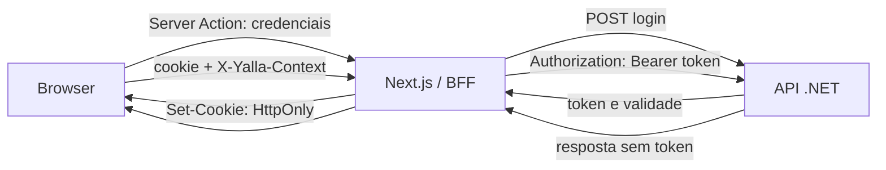

# Fluxo de autenticação por cookie e BFF — Yalla Finance

Este documento descreve a implementação atual. O frontend não mantém um store de sessões em arquivo e não usa `SESSION_STORE_DIR`.

## Como funciona

1. **Login:** uma Server Action envia as credenciais à API. Se necessário, o usuário seleciona a empresa. A API retorna o token da sessão e sua validade; o Next grava o token no cookie `HttpOnly`.
2. **Operações autenticadas:** o browser envia o cookie ao Next. Para mutations, o Next valida a origem e o contexto da sessão, lê o token do cookie e o encaminha à API no cabeçalho Bearer. O token não é acessível ao JavaScript da página.
3. **Logout:** o Next solicita o encerramento à API e remove o cookie. Sessões expiradas ou tokens inválidos exigem novo login.

## Segurança e configuração

- O cookie se chama `yalla-finance-session`, usa `HttpOnly`, `SameSite=Lax` e expiração informada pela API. Em `NODE_ENV=production`, também usa `Secure`, portanto o acesso público deve ser HTTPS.
- Não há store local de sessão, diretório privado ou variável `SESSION_STORE_DIR` para configurar.
- `API_URL` é a origem privada da API .NET acessada pelo servidor Next. Não é exposta ao browser.
- A validação de origem compara a origem do browser com protocolo e `Host` observados pelo Next. Não há configuração de origem pública no runtime; proxy que termina HTTPS precisa de suporte explícito antes de encaminhar mutations autenticadas.
- `X-Yalla-Context` identifica a versão pública da sessão e evita que uma aba antiga opere com outro login. Não autentica nem define o tenant.

## Rastreabilidade no código

| Etapa | Arquivo |
| --- | --- |
| Login e logout | [actions.ts](../src/features/auth/actions.ts) |
| Login servidor a servidor | [auth.server.ts](../src/features/auth/api/auth.server.ts) |
| Cookie e leitura da sessão | [session.ts](../src/features/auth/server/session.ts) |
| Validação de origem e contexto | [session-boundary.ts](../src/features/auth/server/session-boundary.ts) |
| Transporte com Bearer | [api-client.server.ts](../src/services/api/api-client.server.ts) |
| Validação de token e perfil | [session-cookie.ts](../src/features/auth/server/session-cookie.ts) |

## Limites conhecidos

O fluxo de cookie não significa que a aplicação esteja pronta para produção. O [README da solução](../../README.md) registra as pendências atuais de autenticação, persistência e serviços simulados. O mecanismo de assinatura JWT do backend também precisa de configuração estável e compartilhada antes de operar com reinícios ou múltiplas instâncias.
